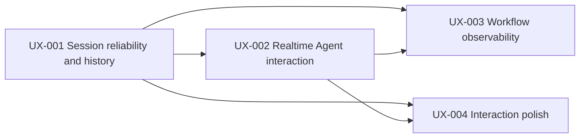

# ResearchHub UX Upgrade Plan — RHL-UX-001 to UX-004

Status: `CTO CONDITIONAL PASS / IMPLEMENTATION PLAN FROZEN; FINAL ACCEPTANCE PENDING`

Audit baseline: `origin/main` `46c53a1a15845a44b28ccbbfc87e9c776c8a6842`

Source audit: [RHL-UX-000](../reports/2026-10-12-rhl-ux-000-audit.md)

CTO decision source: audit Section H. The five decisions below are synchronized with that accepted decision record.

## CTO architecture decisions

These decisions close the audit's five architecture questions and govern UX-001–004:

1. **Every Workflow request belongs to a recoverable Pi session.** UX-001 must resolve/create the server-owned session, preserve the accepted request, and persist its Workflow-run association. The frontend history list is not canonical state.
2. **Use the current registry ID as internal identity.** The current Company Research ID is `company_research`; localized display text is separate metadata. Do not assume `company_deep_research` is a current registry ID.
3. **Use Pi Session metadata for session title/provenance/archive state where supported.** Updates are server-owned and concurrency-safe. Do not add a separate transcript store or Knowledge Schema fields.
4. **Refresh recovery is in scope; Runtime-restart Workflow recovery is not promised.** UX-003 restores a run after a page refresh while the owning Runtime process is alive. Durable recovery across Runtime restart requires a separately approved persistence extension.
5. **Workflow producers own truthful progress and data-availability facts.** Publish only explicit stage transitions, timestamps, safe diagnostics, and provider availability outcomes. Stage counts and percentages are not inferred, and no generic Workflow engine or fixed stage model is introduced.

The implementation must preserve the audit's `NOT_REPRODUCED` status for the historical `company_deep_research` report unless a separate authenticated reproduction establishes otherwise.

## Shared implementation rules

- Keep React + TypeScript + Vite, the local Node Runtime, Pi `AgentSessionRuntime`, HTTP JSON and SSE.
- Pi owns conversation transcript persistence. Workflow owns deterministic execution and status; do not make React list state canonical.
- Use the frozen naming priority `USER > WORKFLOW > FIRST_MESSAGE > DEFAULT`; no extra LLM call. USER title is locked even if renamed back to “新对话”.
- Use structured normalized Workflow arguments and registry metadata for subject and display name. Do not infer progress, stage counts, tool usage or completion percentage.
- Keep Knowledge writes behind the existing Knowledge Production Gateway/validated ChangeSet/Writer. UX session/workflow metadata is not Knowledge Schema.
- Preserve one Runtime process and current server/client adapters. Do not add WebSocket, Redis, a generic event bus, microservice, UI library migration, or independent Agent Runtime.
- In all persistence or event failure cases, show authoritative server state and a recoverable error; do not fabricate accepted messages, Workflow events, or run status.

## RHL-UX-001 — Session Reliability and History Management

**Goal.** Make the submitted request, Pi conversation, and Workflow association recoverable from one server-owned session record; add the frozen two-stage automatic naming and user title lock; support rename, archive/restore, switching, and recent-activity ordering.

**Dependencies.** None. First implementation slice; UX-002 and UX-003 depend on its session identity/link contract.

**Likely files.** `app/runtime/session-runtime.ts`, `app/runtime/contracts.ts`, `app/runtime/server.ts`, `client/src/api/runtime-client.ts`, `client/src/App.tsx`, focused `client/src/App.test.tsx`; `tests/app/runtime/slice-a.test.ts` and `slice-c.test.ts`.

**Reuse.** Pi `SessionManager` list/switch/create, session names and timestamps; `/api/conversations` list/current/messages; existing session runtime replacement serialization and request epoch guard.

**Minimum new capability.**

1. Add a server-side command to ensure/resolve the active persisted conversation before a dispatch is allowed to start. Use that conversation ID as the Workflow's owner and append the submitted user request to that transcript or a clearly typed session activity record before acknowledging start.
2. Persist `workflowRunId` association and title metadata with Pi session metadata, not a client-only array. Expose a validated `conversationId` link from the Workflow/session query path.
3. Implement atomic/serialized metadata transitions for title source, one-shot first-message naming, one-shot first Workflow naming opportunity, rename, archive/restore and metadata revision. Confirm SDK metadata semantics first; keep fields as metadata, not a Knowledge schema change.
4. List active conversations by last activity, with archive filter and bounded title search. Archive must not remove transcript or Workflow/artifact records.

**Naming transition.**

| State/event | Result |
|---|---|
| New empty conversation | `DEFAULT`, display “新对话”; no fabricated persisted title is required. |
| First accepted user submit | If no higher-priority title exists, normalize whitespace and set a ≤24 Unicode-character title with ellipsis. Run once, without waiting for Agent or Workflow. |
| First successfully started Workflow | If title source is below USER and the first Workflow naming opportunity is unused, set `{verified subject} · {localized registry label}`; use stable code where localization cannot be validated; preserve prior title if subject is unavailable. A dispatch intent or `needs_input` response does not count. |
| User rename | Set `USER`, increment metadata revision, lock automatic replacement permanently, including rename back to “新对话”. |
| Delayed/repeated event or concurrent tabs | Apply only if revision/priority checks still allow the transition; never replace USER title. |

**Do not modify.** Transcript storage ownership (Pi), Workflow business algorithms, Knowledge Schema, canonical write flows, or broad `App.tsx` layout.

**Tests.** Unit: Unicode truncation/whitespace and title priority transition table; stale revision conflict; USER lock. Integration: create, first message, dispatch association, rename, archive/restore, list sorting/search and Pi persistence. E2E: submit in empty session, refresh, switch away/back, rename, launch Workflow, refresh again, archive/restore; assert transcript/list/run association are server-backed and exactly one conversation is listed.

**Risks.** Pi session-info updates may be append-only; need a safe metadata fold/serialization strategy. Multi-tab requests share Runtime but can race; compare-and-set must be server-side. Avoid adding a second transcript store or converting an empty session into a duplicate on retries.

**Done when.** Every prompt/Workflow run is traceable to one persisted conversation; session, transcript, and run association survive refresh and Runtime restart; live Workflow status is restored after page refresh only while the same Runtime remains alive; automatic naming follows exact priority/one-shot rules; manual rename and archive are durable; repeated requests do not duplicate records.

## RHL-UX-002 — Realtime Agent Interaction

**Goal.** Show immediate local submission, explicit server acceptance, live Agent/tool state, and safe recovery from errors/disconnects using the current HTTP/SSE design.

**Dependencies.** UX-001 defines conversation/message/Workflow correlation. May proceed after its command IDs and accepted-message storage shape are stable.

**Likely files.** `client/src/App.tsx`, `client/src/api/runtime-client.ts`, `client/src/api/runtime-client.test.ts`, `app/runtime/contracts.ts`, `app/runtime/client-events.ts`, `app/runtime/event-stream.ts`, `app/runtime/server.ts`; focused App and runtime slice tests.

**Reuse.** Existing HTTP 202 command acceptance, `StartedPrompt.accepted` versus `.completion`, safe event allowlist, EventSource auto-reconnect, snapshot endpoints, abort, queue counts and bounded SSE backpressure.

**Minimum new capability.**

1. On submit, render a pending user item immediately with a stable client operation ID; clear the composer only when policy says accepted, or retain it with explicit failure state if rejected.
2. Have the server return/echo the operation ID and actual acceptance state. Carry the same stable correlation through relevant SSE events or correlate by one active Pi operation per session; do not infer from arrival order alone.
3. Reconcile optimistic item with the persisted Pi message without duplication when message snapshot arrives. Make retry create a new operation only after resolving prior acceptance.
4. On EventSource reconnect, show reconnecting state and fetch authoritative current/session/messages/list. A replay log is a follow-up only if snapshot reconciliation cannot satisfy acceptance; do not build an event center by default.
5. Render tool lifecycle and failure safely; never expose raw tool args/results, stack traces, credentials or hidden reasoning. Track elapsed time only from actual start time and monotonic client clock while connected.

**Do not modify.** Pi event producers beyond adding reliable correlation fields, Workflow stage reporting, Knowledge write policy or server transport topology.

**Tests.** Unit: correlation, deduplication, state transitions and reconnect snapshot merge. Integration: delayed dispatch/acceptance, Pi preflight rejection, error/abort, tool failure, SSE disconnect/reopen, duplicate event, event from inactive conversation. E2E: fast acknowledgement, a delayed response with visible pending bubble, retry after rejection, reconnect during stream, no duplicate message, stop.

**Risks.** Pi events do not currently expose a ResearchHub message ID. Define correlation at the Runtime command boundary and reconcile only with verified Pi session state. Be careful that safety redaction can alter event delta display compared with persisted message text.

**Done when.** User submission appears immediately; the UI distinguishes sent/accepted/running/failed based on server evidence; reconnect restores authoritative state; no duplicate transcript item appears; tool status is actual and safe.

## RHL-UX-003 — Workflow Progress and Observability

**Goal.** Show authoritative Workflow identity, subject, real stages, timing, tool/data availability, blocking/failure reason, cancel and output links, with refresh recovery.

**Dependencies.** UX-001 conversation-run association and UX-002 event/operation correlation contract. Keep v0.1 polling unless the approved contract proves server polling is inadequate.

**Likely files.** `app/services/workflow-registry.ts`, `app/services/contracts.ts`, `app/services/workflow-service.ts`, `app/services/research-dispatch-service.ts`, concrete Workflow producers (only where stage boundaries are real), `app/runtime/server.ts`, `client/src/api/runtime-client.ts`, `client/src/App.tsx`, `client/src/app/workflow-polling.ts` and focused tests.

**Reuse.** Registry IDs/labels/input schemas, `WorkflowRunView`, run timestamps/status/cancel, `GET /api/workflows/:runId`, existing polling/backoff, persisted report/bundle/review APIs and run ownership checks.

**Minimum new capability.**

1. Add localized display metadata to the registry and a safe subject projection built from normalized structured arguments or a verified Knowledge entity. Keep internal `workflowType`, external registry ID and display label distinct.
2. Add an optional current stage snapshot and append-only stage history only where Workflow producers emit explicit stage-start/end transitions, timestamps, outcome and safe summary. Stages are producer-defined and may vary by Workflow.
3. Add structured data/tool availability only at provider/plugin boundaries that know whether acquisition succeeded, was unavailable, partial or failed. Preserve source-bound error codes and user-safe diagnostics.
4. Rehydrate Workflow status by the server-owned conversation-run link after page refresh while the same Runtime process remains alive. Do not add Runtime-restart live-run durability in UX-003; terminal reports/bundles remain separately discoverable and must not be presented as active runs.
5. Continue using actual run timestamps for total elapsed time, actual stage timestamps for stage durations, and existing report/bundle link verification. Never compute percent from text or number of stages.

**Do not modify.** Product research algorithms, stage order purely to improve the UI, fixed stage counts, inferred tool calls, or new event infrastructure. Do not couple Pi conversation abort with Workflow cancellation; current architecture treats them independently.

**Tests.** Unit: registry localized metadata; subject projection validation/fallback; stage transition/timing; safe diagnostic projection; no fabricated stage. Integration: company Workflow start, partial provider data, provider block/failure, cancel, result persistence, and same-Runtime refresh restoration; verify session/request/run association persistence separately across Runtime restart without asserting live-run restoration. E2E: start company research, observe only emitted stages and availability, refresh, cancel, verify result artifact belongs to run and session.

**Risks.** The taskbook's `company_deep_research` label differs from current `company_research` registry ID; keep those identity/display concepts distinct. Some existing reports survive process restart while live run records do not; UI must not present an artifact as an active run. Stage instrumentation belongs to each Workflow producer and must use only real boundaries.

**Done when.** Workflow and subject names come from trusted fields; displayed stage/timing/availability are producer-authored; errors and cancel state are honest; refresh recovers the selected run; verified reports/bundles open by matching run ID.

## RHL-UX-004 — Interaction Polish

**Goal.** Improve keyboard/composer behavior, scroll, message actions, history filtering/layout, responsive behavior and accessibility without a broad UI migration.

**Dependencies.** UX-001 history data contract; UX-002 stable message identity/render state. Independent CSS-only refinements can start later once component structure stabilizes.

**Likely files.** `client/src/App.tsx`, `client/src/styles.css`, `client/src/i18n.tsx`, `client/src/App.test.tsx` and focused UI tests.

**Reuse.** Current conversation rails, native textarea/buttons, existing focus styles, responsive grid, i18n helper, and current message/tool projections.

**Minimum new capability.** IME-safe Enter handling (`isComposing` guard), follow-tail scroll that pauses when the reader scrolls away, copy action for message text/code blocks with accessible announcement, empty/loading/error state polish, accessible history search/filter and archive actions backed by UX-001 APIs, responsive keyboard/focus checks.

**Do not modify.** Runtime/session persistence, event protocol, Workflow semantics, component framework or graph behavior. Keep changes within existing React and CSS architecture.

**Tests.** Unit/component: IME composition, Shift+Enter, scroll threshold/pause/resume, copy success/failure announcement, search/filter, empty/loading states, keyboard focus and archived-list actions. E2E: long transcript scroll while streaming, narrow viewport, keyboard-only submit/switch/archive/restore, text selection and copy.

**Risks.** Auto-scroll can steal user reading position; copy controls should not leak hidden content or unsafe tool payloads. Small-screen rail behavior must retain access to the active conversation and composer.

**Done when.** Keyboard, IME, scroll, message actions and history controls work through real UI state; mobile and keyboard-only journeys pass; messages remain readable and users retain control of scroll position.

## Dependencies and parallel execution

- Deliver UX-001 first because the current client dispatch flow and conversation history have no common persisted identity.
- UX-002 and UX-003 should not independently invent run/message/event correlation. Agree on the contract after UX-001 and then implement in separate files where possible.
- UX-002 and UX-003 can run in parallel after the shared contract is accepted: UX-002 owns Pi conversation events/optimistic message reconciliation; UX-003 owns WorkflowRun state/stage producers. Avoid both editing `client/src/App.tsx` at once; use bounded file ownership or integrate sequentially.
- UX-004's pure CSS and accessibility review can be designed in parallel, but message controls/history search should land after UX-001/002 APIs and message identity stabilize.
- No parallel branch should modify the same `session-runtime.ts`, `server.ts`, or `App.tsx` without an explicit integration owner.

## Acceptance gates for each task

1. Named unit/integration/E2E cases from that task pass; fixture evidence is labelled separately from authenticated live provider runs.
2. Required `npm run client:typecheck`, `npm run client:build`, relevant focused tests, and `git diff --check` pass; full repository checks record exact baseline failures if any.
3. Verify no Knowledge Base mutation except an explicitly authorized governed path; UX metadata tests use isolated temporary session/KB roots.
4. Capture actual UI/runtime state for acceptance; do not claim a live E2E from mocked `fetch` or fixture-backed reasoning.
5. Commit and push only the isolated task branch; verify remote HEAD equals local HEAD and worktree is clean; do not merge to `main` automatically.
