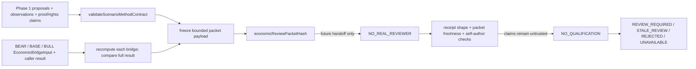

# S4-007B-002-C 私有经济审阅交接实施报告

**任务：** `RHL-CQR-P0-19-S4-007B-002-C`
**冻结基线 / 期望父提交：** `e7463c0e170201c9e7c93b45cbe42f3983dbe75e`
**目标仓库 / 分支：** `rzpeuler/ResearchHub` / `codex/company-research-p0-01-06`
**起点：** worktree `C:\Users\Administrator\Desktop\ResearchHub`；编辑前本地 HEAD、merge-base、远端分支均为冻结 SHA。
**最高交付状态：** `S4-007B-002-C READY_FOR_ARCHITECTURE_REVIEW`；不得由 Codex 自签 ACCEPTED。

## 1. 实施范围、起止状态与提交

编辑前工作树含五个已有修改的 `tests/validation/evidence/*.json`，以及 ignored/untracked 的 `plugins/document/parsers/docling/bridge/__pycache__/`、`runtime-launch.stderr.log`、`runtime-launch.stdout.log`、`tmp/`。这些均为既有用户资产。本批从冻结分支直接工作，没有创建、移动或强制检出其他 worktree。

唯一文件白名单与本次修改：

| 文件 | 变更 |
|---|---|
| `workflows/company-deep-research/scenario-method-contracts.ts` | 只在文件末尾追加私有 packet、receipt、rubric、finding、assessment 类型；未改写既有类型。 |
| `workflows/company-deep-research/scenario-economic-review-handoff.ts` | 新增纯函数冻结包构建、输入/输出复算绑定、规范化哈希和回执结构/新鲜度检查。 |
| `tests/workflows/company-scenario-economic-review-handoff.test.ts` | 新增 16 个 C01–C16 纯合成测试，仅使用 `FICTIONAL-CO` 和 fixture 证据/作者/审阅者。 |
| `docs/engineering/reports/2026-10-29-company-research-s4-007b-002c-implementation.md` | 新增本独立实施报告与证据。 |

未改 `scenario-method-validation.ts`、`scenario-economic-bridge.ts`、既有测试、生产 Workflow、Skill、Provider、Data Policy、公共 Schema/API、Client、Governance 或 Knowledge。实现没有文件/网络 I/O，不调用模型或 Reviewer，也不增加运行预算。

起点 local/remote SHA 为 `e7463c0e170201c9e7c93b45cbe42f3983dbe75e`。最终 commit SHA、其父 SHA、push 结果和 `git ls-remote` 一致性在提交后由 Git 历史与终端结果核验，并在交付摘要中给出。staging 使用且只使用上述四条路径；其余用户 dirty/untracked/ignored 项没有暂存或提交。

## 2. 两种 Review 的边界与数据流

这里的 Review 是经营假设/经济机制的未来独立语义复核交接；它不是 Knowledge Production 的 `ReviewCase`、`ReviewSummary` 或 Review Inbox。依据冻结的 `REVIEW_GOVERNANCE_V0.1.md`，后者是 Knowledge Production 的 durable operational state；本批不触及它。依据 `RESEARCH_SKILL_ARCHITECTURE_V1.md` 和 `RESEARCH-SKILL-ARCH-001.md`，不引入新 Skill、运行层、Knowledge 路径或 Reviewer Provider。



`buildScenarioEconomicReviewPacket` 只会输出 `STRUCTURALLY_PREPARED_FIXTURE_ONLY` 或 `UNAVAILABLE`，恒定 `dispatchAuthorized:false`、`reportEligible:false`、`reviewRequired:true`。结构准备与数据资格是独立状态轴：例如 Phase 1 的数据/权利/版本结论若为 `UNAVAILABLE`，会原样保留在 packet 的 `phase1MethodStatus`、diagnostics、observations 中；结构准备不会把它转换为可消费事实，也不会给缺失值补默认值。结构无效、缺 required driver、桥不可用或复算不一致时，packet 为 `UNAVAILABLE`。

`validateScenarioEconomicReviewReceipt` 只检查回执结构、新鲜度和必要的字符串自审冲突。没有获批的 Reviewer 身份注册表、公钥/签名验证器、执行身份或隔离会话证明。故不同字符串、role/session/execution claim、`identityVerifiedClaim:true`、`independentOfAuthorClaim:true`、signature、authority/attestation reference 皆不构成身份或独立性证明。assessment 永远 `identityVerified:false`、`independenceVerified:false`、`qualificationGranted:false`、`reportEligible:false`；没有“reviewPassed”布尔捷径。

## 3. 冻结载荷与哈希语义

### Phase 1 既有哈希

构建时重新执行 `validateScenarioMethodContract(scenarioMethodInput)`。其既有三个 hash 保持独立并原样收入 packet：

1. `evidenceManifestHash`：Phase 1 observation/evidence manifest。
2. `valueVersionProofSetHash`：Phase 1 版本证明集合。
3. `reviewPacketHash`：既有 `scenarioMethodReviewPacketHash`，绑定 Phase 1 方法输入。

这些只是当前输入完整性/新鲜度绑定，不是历史来源时间、权利或真实性信任根。caller 的 proof/rights/status 仍是 claim；尤其 `sourcePublishedAt` 不替代 `valueVersionAvailableAt`。

### 经济桥输入、复算及范围

输入必须恰好三个 bridge，且顺序严格为 BEAR、BASE、BULL。逐桥重新调用 `calculateEconomicBridge(input)`，将 caller 传入的完整 result 与新算出的完整 result 做 canonical hash 相等比较；不只比较状态、`inputHash` 或 `bridgeHash`。复算要求结构可用、reportEligible 仍为字面 `false`，且组件仍受各自原契约门控制。

交叉绑定逐项检查公司、scenario、analysisAsOf、目标开始/结束/basis、财务范围、报告币种、同一 formulaVersion、Phase 1 方法情景顺序，以及每个 required driver 的 proposal/author/value/mechanism/trigger/unit/currency/scope/basis。Phase 1 情景/driver proposal 和经济 calibration proposal 的集合必须完整、唯一、互相匹配。当前 `EconomicBridgeInput` 没有 `methodId` 或 atomic-skill-owner 字段，因此 packet 显式记录 adapter 限制：不能从 `formulaVersion` 推造 method identity，也不会声称完成该字段证明。

### 新的经济审阅包哈希

`economicReviewPacketHash` 与既有 Phase 1 `reviewPacketHash` 是两个不同版本、不同用途的哈希。前者采用已存在的 `hashCanonicalScenarioValue`（其 SHA-256 canonical JSON 递归排序对象键、保留数组顺序），对以下 payload 计算：

```text
{
  schema: "scenario-economic-review-handoff-hash-v1",
  phase1Hashes: { evidenceManifestHash, valueVersionProofSetHash, reviewPacketHash },
  bridgeBindings: [
    { scenario: BEAR, inputHash, bridgeHash },
    { scenario: BASE, inputHash, bridgeHash },
    { scenario: BULL, inputHash, bridgeHash }
  ],
  payload: complete bounded reviewer packet
}
```

Packet 保留公司、asOf/asOfMode、目标财年与日期/basis、scope/currency、method/rubric/contract 版本、作者集及其 hash、required drivers、逐 observation 的 source/version/rights claims 与 validator assessment、三组 proposal/author/mechanism/calibration/反证/trigger/refs、三桥公式版本/inputHash/bridgeHash/组件值与状态/diagnostics/residual/CFO 差额/校准摘要/调整、Phase 1 diagnostics 和 adapter limits。没有复制源文全文或附加私密身份资料。

明确的无序集合排序规则：作者 ID、observation ID、proposal/ref 集、conflict/missing 字段、经济桥 evidence refs、adjustment IDs、账户/NWC arrays 和校准 proposals 按唯一标识排序；重复 required proposal/bridge/observation ID 不通过排序掩盖。情景数组只有固定顺序 BEAR/BASE/BULL，顺序错误直接拒绝。Phase 1 派生 observation 的 `derivationInputObservationIds` 保留原序；line `inputRefs` 也不被重排。这样改变非语义遍历顺序不使哈希失效，而改变有语义顺序、数值、token/version、rights、author、formula、方法、rubric、asOf、scope/unit、scenario membership 或 adjustment 会改变 hash 或使输入拒绝。

## 4. Reviewer receipt 判定矩阵

回执结构要求 reviewerId、role/session/execution claims、decision claim、packetHash、rubric/contract 版本、原始作者 ID 集及其 hash、逐 scenario/driver/proposal finding、完整八维 rubric（经济因果、证据相关性、校准、反证、可证伪触发、residual、期间、单位）与非空理由。identity-attestation/signature/authority 字段只作为 claim 绑定到回执 hash。

| 情形 | 结构状态 | 身份/资格结果 |
|---|---|---|
| receipt 为 null | `REVIEW_REQUIRED` | 无 Reviewer 调用；身份/独立性均 false。 |
| packet 无效或 packet payload/hash 被篡改 | `UNAVAILABLE` | 不评估 receipt。 |
| 非空但与当前 packet hash 不同的旧回执 | `STALE_REVIEW` | 优先于 ACCEPT claim。 |
| reviewerId/session/execution claim 与任一 BEAR/BASE/BULL author 相同 | `REJECTED` | `independenceConflict:true`；仍不声称可信身份。 |
| reviewerId 空、findings 缺失/重复/越界、rubric 维度/理由缺项、author 集不符 | `REVIEW_REQUIRED` 或 malformed 时 `UNAVAILABLE` | 明确诊断；没有资格提升。 |
| `REJECT_CLAIM` 且回执结构完整 | `REJECTED` | 仅记录 caller 的拒绝 claim，不是已验证语义审阅。 |
| ACCEPT_CLAIM + 八维均声称 QUALIFIED + 假签名/identity claims | `REVIEW_REQUIRED` | `IDENTITY_UNVERIFIED`、`SEMANTIC_REVIEW_REQUIRED`；资格永远 false。 |
| 相同回执重复校验 | 状态/hash 完全一致 | 函数无 I/O、不修改 packet/receipt。 |

畸形、null、非有限数、无效日期、循环输入均经 fail-closed 边界处理；未处理异常不逃逸。回执校验不写文件，不调用模型，也不重写旧 packet。

## 5. C01–C16 合成测试索引

| Case | 覆盖 |
|---|---|
| C01 | 完整三情景包、canonical hash 稳定，dispatch/report 资格恒 false。 |
| C02 | 缺 receipt 保持 REVIEW_REQUIRED。 |
| C03 | 任一作者的自审、空 ID、同作者 session claim；不同 ID 仍不可信。 |
| C04 | 伪造 independent/identity/signature/authority claims。 |
| C05 | 全字段 ACCEPT + rubric QUALIFIED 仍不授资格。 |
| C06 | 方法、rubric、proposal value/version/author、公式、calibration、rights/value-version claim、asOf 改动使旧 receipt STALE。 |
| C07 | bridge input 改动改变 hash；caller 伪造旧 result 被拒；packet payload 篡改被拒。 |
| C08 | bridge 缺失/重复/顺序错、公司/期间/scope/currency 不匹配。 |
| C09 | Phase 1 source proof 缺失仍显示 methodStatus UNAVAILABLE；FCFF/NWC 不完整导致 packet UNAVAILABLE；receipt 不可补值/补资格。 |
| C10 | 三 case 作者集合完整，自审跨 case 检测。 |
| C11 | finding 缺失/重复/越界、rubric 缺维度、空理由或额外维度。 |
| C12 | EML 文字推导与历史/行业极值不能变成 reviewer 语义结论；CFO 差与 FCFF 不互相替代。 |
| C13 | 对象键、proposal/ref 遍历与证据 refs 无序重排 hash 稳定；BEAR/BASE/BULL 顺序变化拒绝。 |
| C14 | null、NaN、非法日期、循环 method/receipt fail closed。 |
| C15 | receipt replay 稳定且 packet/receipt/source input 不变。 |
| C16 | 可保留合成 FCFF 19.5，但没有 PIT/rights/reviewer/report qualification。 |

所有测试文件内公司、来源 ID、数值、作者和审阅者均为虚构 fixture；不包含真实股票价格、真实未来预测、真实来源调用或 Knowledge 操作。

## 6. 验证结果

以下全部为本轮命令实测的退出码和结果；四项验收命令均在最终实现上运行：

| 命令 | Exit code | 测试 / 结果 |
|---|---:|---|
| `node --import tsx --test tests/workflows/company-scenario-economic-review-handoff.test.ts` | 0 | 16 passed / 0 failed，C01–C16。 |
| `node --import tsx --test tests/workflows/company-scenario-economic-bridge.test.ts` | 0 | 22 passed / 0 failed（冻结基线 22 项）。 |
| `node --import tsx --test tests/workflows/company-scenario-method-contracts.test.ts` | 0 | 19 passed / 0 failed（冻结基线 19 项）。 |
| `npm run typecheck -- --pretty false` | 0 | `tsc --noEmit --pretty false` 通过。 |
| `git diff --check` / `git diff --cached --check` | 0 / 0 | 完整工作树与四文件 staged whitelist 均无空白错误。 |

未运行全量 `npm run test:node`、`npm run client:test`、客户端构建、真实 provider/model E2E、真实 Reviewer、双公司研究或模型运行。已知的历史 21 项 Node / 5 项客户端失败没有被冒称为本轮结果。

## 7. 保护资产 SHA-256 前后对照

测试前后只计算下列 5 个预先 dirty 用户 JSON 和 15 个冻结 sidecar 的 SHA-256；两边均为相同哈希，20/20 一致。15 个 sidecar 未打开正文，亦未修改或补造。

| 路径 | 修改/测试前 SHA-256 | 最终验证后 SHA-256 |
|---|---|---|
| `tests/validation/evidence/RHL-EXEC-003-A-004-FIX-002-thesis-authorized.json` | `7252fd35dec70403fd6bb8b3edc6ffadd25211fd158461a1dde30458bf07f442` | `7252fd35dec70403fd6bb8b3edc6ffadd25211fd158461a1dde30458bf07f442` |
| `tests/validation/evidence/RHL-EXEC-003-A-004-FIX-003-event-readonly.json` | `ef0e7475e0464ca1e3950feb348b0d3ed6dc7383e32200faa3fc413207bc641a` | `ef0e7475e0464ca1e3950feb348b0d3ed6dc7383e32200faa3fc413207bc641a` |
| `tests/validation/evidence/RHL-EXEC-003-A-004-FIX-003-industry-readonly.json` | `12c951be5ca88fb35b155187055b0a15a50d212133c9b68088c0d1674500c0fa` | `12c951be5ca88fb35b155187055b0a15a50d212133c9b68088c0d1674500c0fa` |
| `tests/validation/evidence/RHL-EXEC-003-A-004-FIX-003-thesis-references.json` | `61cd5cf5b24a7f0fc10746e0269a845d6e29464614c43738d7585ec075fb4670` | `61cd5cf5b24a7f0fc10746e0269a845d6e29464614c43738d7585ec075fb4670` |
| `tests/validation/evidence/company-quality-pi-default-deny.json` | `4c02302a5b31cec6d93b9298e06a76bd0b834b4bacc914670c7fd06aa6300038` | `4c02302a5b31cec6d93b9298e06a76bd0b834b4bacc914670c7fd06aa6300038` |
| `runtime-data/company-quality-acceptance/2026-10-28-p0-19-risk-row-fix/002384-analysis.json` | `72588193faff4c2e75fb2e07c0b07197619b8c23b9fa49f843e7f05ae34e98b3` | `72588193faff4c2e75fb2e07c0b07197619b8c23b9fa49f843e7f05ae34e98b3` |
| `runtime-data/company-quality-acceptance/2026-10-28-p0-19-risk-row-fix/002384-bundle.json` | `691f3f561b02523f00865f574f6fd373b202c9dad98502abbd61fa3b5958067f` | `691f3f561b02523f00865f574f6fd373b202c9dad98502abbd61fa3b5958067f` |
| `runtime-data/company-quality-acceptance/2026-10-28-p0-19-risk-row-fix/002384-company-research-002384-860916a8-4958-4d29-8da1-56ad5dd1c2c6.md` | `3c14d4fbb29aee31bc434b9c99b98de3e79f6897581c4519a46aa87f236eb91f` | `3c14d4fbb29aee31bc434b9c99b98de3e79f6897581c4519a46aa87f236eb91f` |
| `runtime-data/company-quality-acceptance/2026-10-28-p0-19-risk-row-fix/002384-kb-integrity.json` | `4322cd0b20c70c400615987b06de5d400e45fecc7676cac11cccfd5678ff1f0a` | `4322cd0b20c70c400615987b06de5d400e45fecc7676cac11cccfd5678ff1f0a` |
| `runtime-data/company-quality-acceptance/2026-10-28-p0-19-risk-row-fix/002384-report.json` | `6fa63686b889150551b42eab66b3ce32f4246871f5a3d4be99117d0e0d8917d4` | `6fa63686b889150551b42eab66b3ce32f4246871f5a3d4be99117d0e0d8917d4` |
| `runtime-data/company-quality-acceptance/2026-10-28-p0-19-risk-row-fix/002384-started.json` | `716537e8348f69818ffdc128970e509ed77b367443dc1d4a12292e2d972f87df` | `716537e8348f69818ffdc128970e509ed77b367443dc1d4a12292e2d972f87df` |
| `runtime-data/company-quality-acceptance/2026-10-28-p0-19-risk-row-fix/002384-workflow.json` | `0cf91dfa99a0ca0b1daff3b8711e5e29ab1f07c1d693cfa7f986999adc718ebd` | `0cf91dfa99a0ca0b1daff3b8711e5e29ab1f07c1d693cfa7f986999adc718ebd` |
| `runtime-data/company-quality-acceptance/2026-10-28-p0-19-risk-row-fix/002594-analysis.json` | `60c877932829d114eb02af13304402ec5599b4410df5bc63926f4f646489de35` | `60c877932829d114eb02af13304402ec5599b4410df5bc63926f4f646489de35` |
| `runtime-data/company-quality-acceptance/2026-10-28-p0-19-risk-row-fix/002594-bundle.json` | `1fd11c5f5e7764d23bd4950712faf056efeff09436dd983635b24c156a7a8739` | `1fd11c5f5e7764d23bd4950712faf056efeff09436dd983635b24c156a7a8739` |
| `runtime-data/company-quality-acceptance/2026-10-28-p0-19-risk-row-fix/002594-company-research-002594-82bcc425-d48d-4e55-bc45-111aa8c28ba4.md` | `0f83c1cd96f5962402eae69503e2c53cdf76e16f01a6acf2f0324e986a036604` | `0f83c1cd96f5962402eae69503e2c53cdf76e16f01a6acf2f0324e986a036604` |
| `runtime-data/company-quality-acceptance/2026-10-28-p0-19-risk-row-fix/002594-kb-integrity.json` | `4322cd0b20c70c400615987b06de5d400e45fecc7676cac11cccfd5678ff1f0a` | `4322cd0b20c70c400615987b06de5d400e45fecc7676cac11cccfd5678ff1f0a` |
| `runtime-data/company-quality-acceptance/2026-10-28-p0-19-risk-row-fix/002594-report.json` | `2867b270318b21e334c28246935326dab19fa734c094253bb80637b2c32390c1` | `2867b270318b21e334c28246935326dab19fa734c094253bb80637b2c32390c1` |
| `runtime-data/company-quality-acceptance/2026-10-28-p0-19-risk-row-fix/002594-started.json` | `7f1b87714dea542920e07235206af7db367abfc9f58cb4d043328c49dcb6fef1` | `7f1b87714dea542920e07235206af7db367abfc9f58cb4d043328c49dcb6fef1` |
| `runtime-data/company-quality-acceptance/2026-10-28-p0-19-risk-row-fix/002594-workflow.json` | `43316166217675df70473ed86cf646fa988dd3dfc53be6c4e75f7f32bf6ff7f6` | `43316166217675df70473ed86cf646fa988dd3dfc53be6c4e75f7f32bf6ff7f6` |
| `runtime-data/company-quality-acceptance/2026-10-28-p0-19-risk-row-fix/summary.json` | `e9999cf1ff2173c1ce5d87387abb0c65d9473426b5334547285499f0f51f9228` | `e9999cf1ff2173c1ce5d87387abb0c65d9473426b5334547285499f0f51f9228` |

其他 dirty/ignored 用户资产未打开正文、未改写、未暂存、未提交、未清理；验证后仍按初始状态留在工作树。

## 8. 独立验收 Gate C0–C9

| Gate | 自查状态 | 可核验证据 / 限制 |
|---|---|---|
| C0 Git/范围 | PASS（push 后核验） | 起点远端/本地 exact freeze；最终仅四项白名单 commit 到目标分支；提交前确认无远端漂移。 |
| C1 私有类型 | PASS | 仅 `scenario-method-contracts.ts` 末尾追加；其余既有 Phase 1 / bridge API 不变。 |
| C2 包构建 | PASS | 严格 3 桥、顺序、公司/asOf/期间/scope/currency/formula 和 driver/proposal/author 交叉绑定；显式记录不存在的 methodId adapter 字段。 |
| C3 哈希/确定性 | PASS | 三 Phase 1 hashes + 三桥复算 hashes + 有界 payload；C06/C07/C13/C15 覆盖 staleness、tamper、规范顺序、replay。 |
| C4 独立性 | PASS | 任一作者 ID/session/execution claim 命中均拒绝；不同字符串与所有 identity claims 仍不验证身份。 |
| C5 Reviewer receipt | PASS | 全量 finding/rubric/author/hash/version 对照；缺项有诊断；旧 packet 回执 stale。 |
| C6 信任/资格门 | PASS | 所有路径永久 reportEligible=false、dispatchAuthorized=false、qualificationGranted=false；receipt 的 ACCEPT 也只能 REVIEW_REQUIRED。 |
| C7 Tests | PASS | C01–C16 16/16，经济桥 22/22，Phase 1 19/19，typecheck 0；无真实 Reviewer/provider/model E2E。 |
| C8 数据/资产 | PASS | 五份用户 JSON + 15 sidecar 前后 SHA-256 20/20 相同；没有读取 sidecar 正文或写 Knowledge。 |
| C9 报告/停机 | PASS | 本报告、四文件范围、命令证据、剩余批准项；最高状态明确 READY_FOR_ARCHITECTURE_REVIEW。 |

## 9. 产品状态、风险与后续批准边界

真实项目状态不变：BYD `002594` 与东山精密 `002384` 的既有 T0 仍各 `17/19 BLOCKED`；`bull-base-bear` 与 variant-perception 仍未满足资格；独立真实经济 Reviewer 仍为 0；19/19 门与 P0-19 均 `NOT_ACCEPTED`。本批只完成私有、纯函数的 synthetic review handoff 契约和 receipt 结构校验。没有发起 Reviewer、数据或模型调用，没有 T1 run、旧 T0 重跑、预测/股价/目标价实数、生产接线或 Knowledge mutation。

未来任何下列工作均需单独批准，不能由本 packet 或 receipt 自动开启：

1. 可信 Reviewer 身份注册、签名/认证验证、隔离执行会话机制及语义责任边界。
2. 来源许可、消费者权限、逐值 PIT/version proof 与可信 trust root。
3. 生产 Workflow handoff 与消费者/发布资格改动。
4. Reviewer 执行预算、retry budget 或供应商费用。
5. T1 数据/消费者测试、BYD 与东山的真实独立复核及 19 章完整验收。

Codex 不签发 ACCEPTED；等待架构师对目标远端提交的源码、diff 和测试证据做独立审查。最高交付状态保持 `S4-007B-002-C READY_FOR_ARCHITECTURE_REVIEW`。
